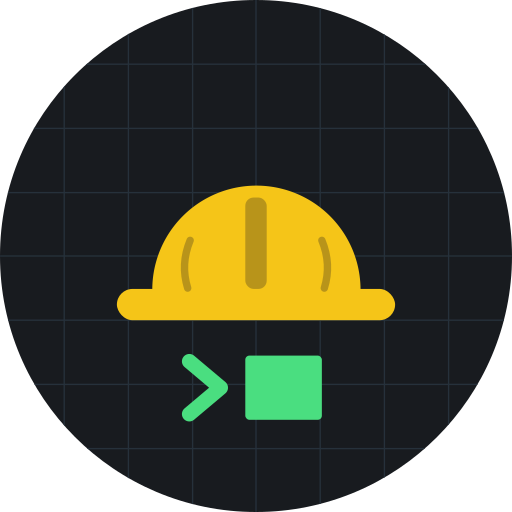

  

<h2 align="center">토목AX</h2>

읍면동 토목직이 만드는 소규모 건설공사 설계 자동화

---

### 👷 소개
경상북도 상주시 토목직 공무원입니다. 도로·배수·농업기반 시설의 자체설계(총공사비 3천만원 이하)를 하면서,
반복되는 야장 정리·도면·수량산출 작업을 코드로 자동화하고 있습니다.

### 🎬 시연 영상 (1분 38초)

- 한 건 설계: 예전 3시간 → **지금 19초 + 담당자 확인**
- 실제 설계 33건(도면 190장)으로 규칙을 정리하고, 올해 실제 설계 9건에 사용 중
- 고칠 때마다 자동 검사 1,322개로 계산을 다시 확인(2026-10-25 기준)
- 엔진 처리 시간 실측: 야장 입력 → 설계도서 묶음 한 건 6~8초(사람 확인 제외)

영상 속 마을·필지·항공영상·단가는 가상입니다. 그림을 누르면 영상이 열립니다.

### 🛠 하고 있는 일
- **소규모 건설공사 설계 자동화** — 야장 → 위치도·편입예상필지 조서 → 도면(DXF) → 수량산출서(xlsx) → 내역
  - 현장 사진의 GPS 위치가 그대로 노선 점이 되어 항공사진·지적 위에 올라갑니다
  - 실제 설계 건을 확정 내역서와 원 단위까지 맞춰 검증하며 규칙을 쌓습니다
  - 계산은 코드가, AI는 규칙 정리·검토·문서 작성을 맡습니다
  - 👉 [sangju-estimate-public](https://github.com/lsh573928-rgb/sangju-estimate-public)
- **10월에 더한 것** — 평소 보던 서류 모양 그대로 확인하고 고치는 쪽으로
  - 서류 작업대: 수량산출서·내역서·도면·야장을 늘 보던 모양 그대로, 새 건부터 결과 파일까지 한 화면에서
  - 말로 고치기: "NO.9 폭 3.8m로 바꿔" → 고칠 목록 → 담당자가 보고 적용. 애매하면 되묻고, 계산 결과를 직접 바꾸는 말은 막습니다(로컬 AI 채점 126문항: 맞게 처리 72·잘못 고침 1·짐작 고침 0)
  - GPS RTK 좌표 → 종평면도, 종단 계획선 → 횡단면도·토적 연동
  - 지난 건 양식 가져오기, 업체 설계도서 교차 검사·검토 보고서(hwpx)
  - 설계변경 대비표·변경사유서, 출장복명서, 현장사진 위치도, 예산서 읽기, 유역 참고 계산(시제품)
- 행정안전부 AI 챔피언 그린·블루 인증
- 업무용 GPTs 제작·배포, 공공부문 AI 학습 커뮤니티 운영

### 📐 원칙
- 실제 지번·금액·업체 정보는 공개하지 않습니다
- 설계기준·표준품셈·계약 집행기준을 근거로 남깁니다
- 현장에서 바로 쓰는 것을 우선합니다

### 💬 연락
의견·제보는 저장소 Issues로 남겨 주세요.

- 🧵 Threads: [@civil__ax](https://www.threads.com/@civil__ax) — 개발 과정과 현장 이야기
- 💬 카카오 오픈프로필: [토목AX](https://open.kakao.com/me/tomokax)

